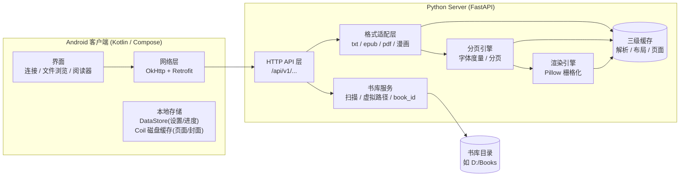
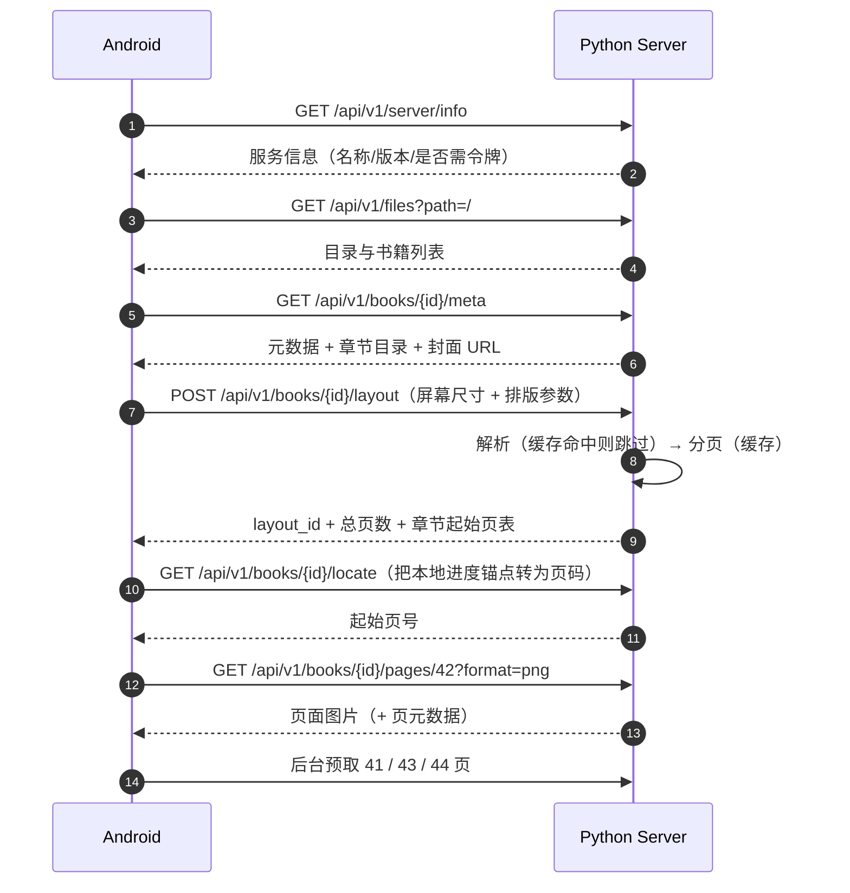

# LocalNetViewer 设计文档

| 项 | 内容 |
|---|---|
| 版本 | v0.3（已实现并经真实构建 + 端到端运行验证） |
| 日期 | 2026-10-03 |
| 状态 | 服务器与客户端均已实现；缺陷修正记录见 13 节 |
| 范围 | 局域网电子书阅读系统：Python 服务器 + Android 客户端 |

**一句话描述**：PC 上的 Python 服务器负责书库管理、格式解析、分页与页面渲染；Android 通过 IP 连接服务器，浏览文件并"逐页"阅读电子书与漫画，书籍不整本下载。

**现有工程状态**：

- `android/`：Kotlin 2.2.10 + Compose BOM 2026.02.01，`compileSdk 37` / `minSdk 24` / `targetSdk 36`，
  包名 `com.zqr.localnetviewer`。`gradlew :app:assembleDebug` 通过。
- `server/`：FastAPI + Pillow 完整实现，`pip install -e .` 可用，`pytest` 全部通过。
- 已用"宿主机服务器 + Android 模拟器"跑通完整阅读闭环（见 13 节 v0.3）。

---

## 目录

1. [需求分析](#1-需求分析)
2. [总体架构](#2-总体架构)
3. [关键设计决策](#3-关键设计决策)
4. [服务器设计](#4-服务器设计)
5. [HTTP API 设计](#5-http-api-设计)
6. [Android 客户端设计](#6-android-客户端设计)
7. [格式支持与解析细节](#7-格式支持与解析细节)
8. [性能设计](#8-性能设计)
9. [安全设计](#9-安全设计)
10. [工程结构与里程碑](#10-工程结构与里程碑)
11. [风险与备选方案](#11-风险与备选方案)
12. [术语表](#12-术语表)
13. [Review 记录](#13-review-记录)

---

## 1. 需求分析

### 1.1 功能需求

| 编号 | 需求 | 说明 |
|---|---|---|
| F1 | 连接服务器 | Android 通过输入 IP:端口 连接；记住历史地址；连接检测与错误提示 |
| F2 | 文件浏览 | 浏览服务器书库目录，显示文件夹与书籍；书籍显示格式、大小、封面（懒加载） |
| F3 | 阅读电子书 | 打开 txt / epub / pdf（fb2 等后续）；**服务器逐页提供页面，客户端不下载整书** |
| F4 | 阅读控制 | 翻页（滑动/点击）、目录跳转、进度条跳页、字号/行距/边距/主题调整 |
| F5 | 进度记忆 | 每本书记录阅读位置；改字号、横竖屏切换后位置不丢失 |
| F6 | 全文搜索（后续） | 服务器搜索 TXT/EPUB 内容，返回结果并跳转到对应页 |
| F7 | 漫画阅读 | CBZ / CBR / CB7 / CBT / 图片文件夹视为漫画；阅读方向（日漫右→左）、适应模式（铺满屏幕（默认）/整页/适应宽度/适应高度）、双页跨页、长条漫（条漫）连续滚动 |
| F8 | 文件夹图集 | 浏览目录时可"不打开文件、直接打开当前文件夹"查看其中图片：当前目录与含图片的子文件夹均提供"作为图集打开"入口；图集复用漫画阅读器 |

### 1.2 非功能需求

- **延迟**：局域网内翻页 ≤ 100ms（页面已缓存时）；未命中渲染 ≤ 300ms/页；预取使连续阅读无等待。
- **带宽**：文本页 50–200KB/页；漫画页（视口缩放）约 200–600KB/页，原图模式更大；服务器按客户端上报的屏幕像素渲染。
- **服务器**：普通 PC / 树莓派可运行；支持多客户端并发；无数据库依赖（缓存 + 索引文件）。
- **平台**：服务器 Windows / Linux / macOS（Python 3.11+）；Android 8.0+（minSdk 24）。
- **安全**：仅面向局域网；可选访问令牌；只读服务；路径穿越防护。
- **可靠性**：服务器重启后客户端能透明恢复（布局缓存落盘）；网络断开有明确提示并可重连。

### 1.3 明确不做（Out of Scope）

- 不支持 DRM 加密书籍。
- 不提供公网访问、账号体系、多用户权限。
- 不提供上传 / 删除 / 编辑文件（纯只读；后续如需再加）。
- 不做客户端本地整书下载（这是本项目的核心约束）。

---

## 2. 总体架构

### 2.1 架构图



### 2.2 核心工作流：打开一本书



### 2.3 页面寻址模型（Anchor）

所有阅读位置用**锚点 Anchor** 表示，而不是页码：

```json
{ "chapter": 3, "block": 10, "char": 420 }
```

- `chapter`：章索引（TXT 未分章时为 0）。
- `block`：章内块索引（段落 / 标题 / 图片）。
- `char`：块内纯文本字符偏移（页起始锚点；图片块为 0）。

作用：

- 改字号 / 边距 / 旋转屏幕会导致页码变化，但锚点在文档中的位置不变；
- 进度只存锚点；重新布局后由服务器把锚点换算成新页码（`/locate`），实现"不失位"；
- 固定版式格式（PDF/漫画）用 `chapter=0, block=页序号, char=0` 统一表示；条漫用 `chapter=0, block=源图索引, char=该图内纵向像素偏移`，改视口高度重切片后仍能定位到同一纵向位置。

---

## 3. 关键设计决策

### 3.1 为什么由服务器分页并渲染

- 客户端保持"瘦"：EPUB 解析、编码检测、字体度量、分页、排版只在服务器实现一次。
- 新增格式只改服务器，Android 无需发版。
- 页面布局由服务器端到端决定（所见即所得），彻底规避"服务器分页 vs 客户端字体差异"的错位问题。
- 符合核心约束：整书文件永不传输，只按页传输。

代价：阅读依赖网络（局域网可接受）；纯图片页无法直接选词（由 JSON 模式 + 文本搜索弥补）。

### 3.2 两种页面输出模式（同一套分页结果）

| 模式 | 说明 | 用途 |
|---|---|---|
| **PNG 模式（默认，P1）** | 服务器把一页栅格化为图片返回；客户端只是"翻页图片查看器" | 实现简单、排版百分百一致、支持任意复杂内容 |
| **JSON 模式（扩展，P4）** | 返回该页的文本行与图片块；客户端用原生文本绘制 | 文本清晰、可选词、可 TTS、流量更小 |

关键约定：**分页边界永远由服务器决定**。JSON 模式下服务器按"行"下发（`lines: [...]`），客户端逐行绘制、不做重排，因此两种模式页码完全一致。为保证行宽也一致，客户端**必须使用与服务器相同的字体文件**（经 `/render/fonts/{id}/file` 获取并本地缓存）；若暂用系统字体，对超出可用宽度的行做最大 10% 横向压缩，仍超出则截断并记录警告（服务器排版仍按原始宽度计算，仅显示兜底）。

### 3.3 重新布局不失位

1. 阅读设置 / 屏幕几何发生变化 → 客户端拿**当前页起始锚点**（页元数据中携带）；
2. `POST /layout`（新参数）得到新 `layout_id`；
3. `GET /locate`（锚点 + 新 layout_id）得到新页码；
4. Pager 跳转到新页。

### 3.4 三层缓存

| 层 | 内容 | 键 | 位置 |
|---|---|---|---|
| 解析缓存 | 统一文档模型 DocumentModel | `book_id + parser_version` | 磁盘 `cache/parsed/` |
| 布局缓存 | PageMap（页码 ↔ 锚点、章节起始页） | `book_id + layout_id` | 内存 LRU + 磁盘 `cache/layouts/` |
| 页面缓存 | 渲染出的 PNG/JPEG | `book_id + layout_id + theme + scale + page`（固定版式另加 `fit/quality`） | 内存 LRU（字节 + 张数双上限） |

页面图片在客户端还有 Coil 磁盘缓存兜底，因此服务器页面缓存不需要落盘。

### 3.5 通信协议选择

- **REST + JSON + 二进制图片**，HTTP/1.1 keep-alive；不需要 WebSocket（无双向实时需求）。
- 页面图片使用强缓存头（`ETag` + `immutable`），layout_id 变化即 URL 变化，天然失效。
- 服务器地址发现：手动输入 IP 为主；mDNS 自动发现（`_localnetviewer._tcp`）为 P4 可选项。

### 3.6 漫画（固定版式）策略

漫画不重排文本，按"图片即页"处理，与文本书共用同一套 page / anchor / 缓存体系：

- **取页两种方式**：`fit=viewport`（服务器缩放到视口，控制流量，默认）/ `fit=original`（原始图片字节直通，保真）；两者页号与 layout_id 相同，切换无需重新分页。
- **阅读方向**：客户端翻转 Pager（日漫右→左）；服务器在跨页拼接时按方向调整页序。
- **条漫（Webtoon）**：超高长图由服务器按视口高度切片成多"页"，客户端纵向连续滚动——这是"服务器准备页面"模型对条漫的天然适配；条漫锚点为 `(源图索引, 纵向偏移)`，旋转屏幕重切片后位置不漂移（见 2.3）。
- **容器统一抽象**：CBZ/ZIP、CBR/RAR、CB7/7z、CBT/TAR 与"图片文件夹即书"统一为一个 comic adapter，页序自然排序。
- **文件夹图集（虚拟书）**：浏览目录时可直接把当前文件夹注册为一本虚拟漫画（`format: "gallery"`，见 7.5）并打开，无需打开任何具体文件；虚拟书 id 由目录路径生成，目录内增删图片不改变 id、进度保留。

---

## 4. 服务器设计

### 4.1 技术栈

| 组件 | 选型 | 理由 |
|---|---|---|
| Web 框架 | FastAPI + Uvicorn | 异步、类型化、性能好、自带文档 |
| 配置 | PyYAML + Pydantic 校验 | 单文件配置，易改 |
| TXT | charset-normalizer | 编码检测（UTF-8 / GBK / GB18030 等） |
| EPUB | ebooklib + BeautifulSoup4 + lxml | 成熟的 EPUB 解析组合 |
| PDF | pypdfium2 | 渲染质量好、许可证友好（避免 AGPL 的 PyMuPDF） |
| 漫画容器 | zipfile / rarfile / py7zr / tarfile | CBZ/ZIP、CBR/RAR、CB7/7z、CBT/TAR、图片文件夹；页序自然排序 |
| 渲染 | Pillow + FreeType | 文本行绘制、图片缩放、封面生成 |
| 字体 | 内置 Noto Sans SC（思源黑体） | 不依赖系统字体，保证中文渲染 |
| 其它 | qrcode（可选）、watchfiles（可选） | 控制台二维码 / 书库变化监听 |

Python 3.11+；不引入数据库（索引与进度均为 JSON/SQLite 可选）。

### 4.2 配置文件（config.yaml）

```yaml
server:
  host: 0.0.0.0
  port: 8765
  auth_token: ""            # 留空则不需要令牌；填写后客户端需携带 X-Auth-Token

library:
  roots:
    - name: 我的书库
      path: D:/Books
  include_ext: [".txt", ".epub", ".pdf", ".cbz", ".cbr", ".cb7", ".cbt", ".fb2", ".mobi", ".azw3"]
  show_all_files: false     # true 时列出所有文件，但非电子书不可打开
  sort: natural             # 目录优先 + 数字感知自然排序

gallery:
  folder_as_book: true      # 图片文件夹可"作为图集"打开（浏览页提供入口）
  min_images_in_folder: 1   # 显示"打开为图集"入口所需的最少图片数
  recursive: false          # 图集是否包含子文件夹中的图片
  show_image_files: false   # 是否在目录列表中直接列出单张图片文件

comic:
  skip_entries: ["__MACOSX/*", "*/.*", "Thumbs.db", "desktop.ini"]
  default_fit: viewport     # viewport(按视口缩放，默认) | original(原图直通)
  jpeg_quality: 85          # 缩放重编码质量
  strip_min_aspect: 1.5     # 高/宽 超过该值的长图可启用条漫 strip 模式

render:
  fonts_dir: assets/fonts
  default_font: NotoSansSC-Regular
  max_page_pixels: 4000000  # 单页最大像素数（防止内存爆炸）
  jpeg_for_photo_pages: true

cache:
  dir: cache
  parsed_max_mb: 4096       # 解析缓存磁盘上限
  page_lru_bytes: 536870912 # 页面缓存内存上限（字节，512MB）
  page_lru_pages: 512       # 页面缓存张数上限（与字节上限双控）

limits:
  max_book_mb: 2048         # 单本书文件上限，超过拒绝并提示
  max_page_bytes: 52428800  # 单页图片字节上限（原图直通），超出强制缩放
  max_source_pixels: 30000000  # 源图解码像素上限（Image.MAX_IMAGE_PIXELS），防图片炸弹
  parse_timeout_s: 60       # 单本书解析/分页超时 → PARSE_FAILED
```

### 4.3 模块结构（规划）

```
server/
├─ pyproject.toml
├─ config.yaml
├─ run.py                     # python run.py --config config.yaml
└─ app/
   ├─ main.py                 # FastAPI 装配、路由注册、生命周期
   ├─ config.py               # 配置加载与校验
   ├─ api/
   │  ├─ routes_server.py     # /server/info, /render/fonts
   │  ├─ routes_files.py      # /files
   │  ├─ routes_books.py      # /books/{id}/meta|cover|asset
   │  ├─ routes_read.py       # /books/{id}/layout|pages|locate|search
   │  ├─ routes_progress.py   # /progress（可选，P4）
   │  └─ errors.py            # 统一错误模型与异常处理器
   ├─ services/
   │  ├─ library.py           # 书库扫描、虚拟路径、book_id 指纹、索引
   │  ├─ gallery.py           # 文件夹图集：图片枚举/自然排序、虚拟书注册（path → book_id）
   │  ├─ layouts.py           # LayoutProfile 注册表（profile → layout_id）
   │  └─ search.py            # 全文搜索（P3）
   ├─ formats/
   │  ├─ base.py              # BookAdapter 接口 + DocumentModel 定义
   │  ├─ txt.py               # 编码检测 + 章节切分
   │  ├─ epub.py              # spine/toc/HTML → 块模型，内嵌资源
   │  ├─ pdf.py               # 固定版式直通（渲染即页）
   │  ├─ comics.py            # 漫画容器（CBZ/CBR/CB7/CBT/图片文件夹）：图片即页
   │  └─ registry.py          # 扩展名 → 适配器
   ├─ layout/
   │  ├─ engine.py            # 文本行分割 + 分页 → PageMap
   │  ├─ fonts.py             # 字体发现、缓存、字符宽度表
   │  └─ anchors.py           # 锚点 ↔ 页码 双向换算
   ├─ render/
   │  ├─ raster.py            # Pillow 绘制页面（背景/文本行/图片）
   │  └─ jsonout.py           # JSON 模式序列化
   ├─ models/
   │  └─ schemas.py           # Pydantic DTO
   └─ assets/fonts/           # NotoSansSC-Regular.otf 等
```

### 4.4 统一文档模型（DocumentModel）

所有文本类格式解析后统一为如下结构（即解析缓存内容）：

```json
{
  "book_id": "b7f3a2c1d9e04e21",
  "format": "epub",
  "meta": {
    "title": "三体",
    "author": "刘慈欣",
    "language": "zh",
    "total_chars": 187654
  },
  "chapters": [
    {
      "index": 0,
      "title": "第一章 科学边界",
      "blocks": [
        {"type": "heading", "level": 1, "text": "第一章 科学边界"},
        {"type": "paragraph", "spans": [{"text": "汪淼", "style": "none"}, {"text": "抬头看见", "style": "bold"}]},
        {"type": "image", "asset": "Images/figure1.jpg", "w": 800, "h": 600},
        {"type": "separator"}
      ]
    }
  ]
}
```

块类型：`heading` / `paragraph`（spans 保存粗体/斜体）/ `image` / `separator`。固定版式格式（PDF 与漫画）不生成此模型，直接以"页"为单位（见 7.4）。

### 4.5 字体与度量

- 字体来源：`render.fonts_dir`（内置目录，用户可放 Noto Sans SC）+ 系统字体目录兜底；
  `GET /render/fonts` 暴露字体列表供客户端设置页选择。
- **默认字体必须真的画得出中文**：服务器按"光栅化后与 .notdef 方框比较"的方式逐个探测系统字体，
  优先选内置中文字体，其次选任何含中文字形的字体，最后才退回按字体名猜测（`CJK_HINTS`）。
  这一步不能省 —— 直接取"字体表里第一个"在 Windows 上会选中 Arial，整本中文渲染成方框。
- **字符宽度表**：分页需要知道每个字符的宽度。逐字符调用 FreeType 度量对 5MB 文本太慢，方案：
  - ASCII / 拉丁范围：按字体 size 预计算宽度表（约几百项，缓存复用）；
  - CJK / 全角标点：按全角宽度（= font_size）处理；
  - 结果：每字符宽度 O(1) 查表，10MB 文本分页目标 < 2s。

### 4.6 分页引擎

输入：`DocumentModel + LayoutProfile`；输出：`PageMap`。

`LayoutProfile` 全部使用**客户端上报的物理像素**（客户端把 sp/dp 换算成 px 后上报）：

```json
{
  "viewport": {"w": 1080, "h": 2160},
  "margin": {"left": 54, "right": 54, "top": 48, "bottom": 96},
  "font": {"family": "NotoSansSC-Regular", "size_px": 52, "line_height": 1.6, "letter_spacing_px": 0},
  "paragraph": {"spacing_px": 20, "first_line_indent_chars": 2},
  "image": {"max_width_ratio": 1.0, "max_height_ratio": 1.0},
  "chapter_new_page": true,
  "mode": "flow"
}
```

- `viewport` 为**窗口全尺寸**（不随系统栏显隐变化）；`margin` 必须至少覆盖常态 WindowInsets（状态栏 / 刘海 / 手势条），并与用户边距取较大值，保证任何系统栏状态下正文不被遮挡；因此切换沉浸模式**不触发重新布局**（多余区域由客户端显示主题背景）。
- `layout_id = sha1(几何相关字段 + 解析器版本 + 分页引擎版本 + 已解析字体 id)[:12]`
  （**theme 与 render_scale 不参与**，它们只影响渲染，不影响分页）。
  - 只哈希"几何"会留下两个陷阱：解析器升级后块索引可能变化，旧 PageMap 的锚点会指向错误
    位置（渲染成空白页）；客户端默认 `family="auto"`，字体目录变化会改变实际字宽，旧分页
    随之失真。把这两项一并纳入哈希后，变化即产生新的 `layout_id`，旧缓存自然失效。
- `mode`：`flow`（文本重排）/ `fixed`（PDF、漫画单页）/ `strip`（条漫切片）；`fixed` / `strip` 不使用字体、段落等文本字段。
- `fixed` / `strip` 的页面集合在每次 `/layout` 时实时枚举（不缓存页内容）；容器/目录内容变化后旧页码可能越界，返回 `PAGE_OUT_OF_RANGE`，客户端提示刷新（重新 `/layout`）。
- 分页算法（单次线性扫描）：
  1. 每个块按字符宽度表贪心折行，得到行列表；
  2. 段落首行缩进、段间距、图片按可用宽等比缩放后折算高度；
  3. 按可用高度累计切页；`chapter_new_page=true` 时每章另起一页；
  4. 记录每页起始锚点与首行文本（用于搜索定位），生成 PageMap。
- 文本行渲染使用左对齐；超宽单词（英文/URL）做字符级强制断行（暂不做连字符排版）；行首避头尾（不出现 `。，、！？：；」』）` 等）作为 P2 打磨项。
- `PageMap` 落盘（`cache/layouts/{book_id}/{layout_id}.json.gz`），服务器重启后 layout_id 依然有效（LRU 淘汰策略保证磁盘可控）。

### 4.7 渲染引擎（PNG 模式）

- 画布 = `viewport.w × viewport.h × render_scale`（scale 默认 1.0，允许 0.5–2.0，并受 `max_page_pixels` 限制）。
- 绘制顺序：主题背景色 → 文本行（前景色）→ 图片（等比缩放、居中）。
- 输出格式：文本为主页 → PNG（文字锐利、压缩好）；照片为主页 → JPEG q85（体积小）。
- 图片缩放统一用 LANCZOS 重采样；进入渲染前校正 EXIF Orientation（`ImageOps.exif_transpose`），避免手机拍摄/导出图片横竖颠倒。
- 解码防护：按 `limits.max_source_pixels` 设置 `Image.MAX_IMAGE_PIXELS`；JPEG 大图先 `Image.draft()` 降采样再裁剪/缩放，防图片炸弹与内存峰值。
- 超限行为：`fit=original` 不解码、不受像素限制；缩放模式下超出 `max_source_pixels` 时先 draft 降采样，仍失败则该页返回 `PARSE_FAILED`（detail 标注页码），不影响其它页。
- 页码 / 章节名**不由服务器绘制**，客户端自行叠加半透明底栏（避免因叠加内容重复渲染）；客户端通过 `margin.bottom` 预留底栏空间，通过 `margin.top` 预留顶栏空间（见 6.3）。
- `theme` 参数决定配色，服务器内置预设：

| 主题 | 背景 | 正文 |
|---|---|---|
| white | `#FFFFFF` | `#222222` |
| paper | `#F5F0E6` | `#2B2B2B` |
| sepia | `#F0E2C8` | `#3B2E1E` |
| green | `#CCE8CF` | `#1F2A1F` |
| dark | `#111418` | `#C8C8C8` |

固定版式（PDF / 漫画 / 文件夹图集）取页策略：

- `fit=viewport`（默认）：按 `viewport.w × render_scale` 等比缩放后重编码（JPEG q=`comic.jpeg_quality`），控制流量；
- `fit=original`：原始图片字节直通（不重编码、保真，适合高清扫描与放大查看；带宽较大）；支持 HTTP `Range`（206）与 `Content-Length`，便于大图分块加载；
- 条漫切片：`mode=strip` 时把超高长图按视口高度（可加重叠像素）切成多页，切片直接裁剪原图、不重编码。

### 4.8 书库与 book_id

- 虚拟路径：`/` 列出所有书库根（按 `name`），`/我的书库/小说/xxx.epub` 逐级浏览；第一个路径段映射到配置的根目录。
- 路径安全：URL 解码后规范化（`resolve`），必须仍位于对应根目录内，否则拒绝（防目录穿越）。
- 符号链接：默认不跟随（扫描时跳过），避免软链逃逸出书库；需要收录外部目录时在 `roots` 中显式添加。
- 索引构建：后台扫描并增量更新（按 mtime/size 跳过未变文件）；未就绪时 `/files` 返回已索引部分并携带 `scanning: true`。
- **目录变化监听（可选）**：`library.watch=true`（默认开）且安装可选依赖 watchfiles（`pip install -e ".[watch]"`）时监听全部书库根——OS 原生通知（Windows `ReadDirectoryChangesW` / Linux inotify / macOS FSEvents），内核推送事件，空闲零开销，开销只随事件频率、不随书库大小涨。事件按 `library.watch_debounce_s` 防抖合并后触发增量重扫（复用索引构建，未变文件直接跳过）；持续写入（大文件拷贝）按最短间隔节流（默认 10s），窗口内事件只累计、合并进下一次重扫，无事件风暴也不丢事件；重扫拿不到扫描锁（启动扫描未结束等）时重试直到真正执行。无内容变化的重扫不重写索引文件。watchfiles 缺失、根目录不存在或监听异常时自动降级为"仅启动扫描"，只记日志不影响服务。
- **book_id = 内容指纹**：`sha1(文件大小 + 文件头 1MB)` 取前 16 位十六进制。
  - 优点：书籍移动 / 改名后阅读进度不丢；索引缓存于 `cache/index.json`，避免每次扫描重算。
  - **已知盲区与对策**：1MB 之后的**等长编辑**（TXT 勘误的常见形态）不会改变指纹。
    因此 `book_by_id` 在检测到 size/mtime 变化时，**无论指纹是否改变**都要清空该 book_id 的
    全部派生缓存（布局 / 解析 / 页面图 / 封面）；指纹真的变了则返回 `BOOK_NOT_FOUND`，
    让客户端重新扫描拿到新 id。少了这一步，服务器会永远返回旧分页与旧页面图。
- **虚拟书（文件夹图集）**：`book_id = sha1("gallery:" + 虚拟路径)[:16]`，由目录路径生成。取舍：目录内增删图片不会改变 id（进度保留）；目录移动 / 改名会导致该图集进度失效（以新路径重新打开）。
- 目录图片数（图集入口用）：书库扫描时计算并缓存（目录 mtime 变化时重算），避免每次列目录都全量遍历。
- 封面：EPUB 提取内嵌封面；PDF 首页缩略；漫画取第一张图；TXT 用 Pillow 生成标题文字封面。均可带 `?w=` 缩略。

### 4.9 缓存与并发

- 渲染是 CPU 密集（Pillow），在 `asyncio.to_thread` 的线程池中执行（`max_workers = CPU 核数`）。
- **异步边界**：`async` 路由里任何可能做重 IO 的调用都必须离开事件循环，包括
  `open_adapter`（CBR 列目录要起 `unrar` 子进程、PDF 要 `PdfDocument`、MOBI 首次打开要跑
  `ebook-convert`，最长可达 `parse_timeout_s × 4`）、`require_book`（文件被就地替换时要读 1MB
  文件头）、`require_layout`（缓存未命中时 gzip + JSON 读盘）。漏掉任何一处，一个客户端的
  首次打开就会冻结所有客户端的翻页。
- 同一 `(book_id, layout_id)` 的首次分页加锁，避免并发重复计算；锁表按**引用计数**回收
  （按 `locked()` 判断会把"已取到锁对象但还没 acquire"的锁换掉，互斥随即失效）。
- `LayoutStore.get` 的磁盘读取在锁外进行：持全局锁读盘会把所有书的页面请求串行化。
- 超时执行（`run_with_timeout`）用**守护线程 + 有界并发**：`ThreadPoolExecutor` 的工作线程
  非守护且会被 atexit join，超时任务跑不完时表现为"进程退不掉"；同一个 key 上一次还在跑时
  直接失败，避免把同一本书重复解析。
- **分页本身也受超时保护**：`parse_timeout_s` 只包住 `adapter.document()` 是不够的 ——
  "整本没有换行/空格"的 TXT 会让分页自己跑很久。分页与解析一样走 `run_with_timeout`。
- 单进程部署（Uvicorn `workers=1`），内存缓存天然一致；后续如需横向扩展再引入共享缓存。
- 页面缓存按**字节上限 + 张数上限双控** LRU 淘汰（文本页与漫画原图页体积差异大）；解析缓存按磁盘配额淘汰（LRU）。

### 4.10 启动与部署

```
cd server
python -m venv .venv && .venv\Scripts\activate    # Windows
pip install -e .
python run.py --config config.yaml
```

启动时打印：

```
LocalNetViewer Server v0.1
书库: 我的书库 (D:/Books, 123 本)  [扫描完成]
可用地址:
  http://192.168.1.10:8765   (以太网, 推荐)
  http://10.8.0.3:8765       (VPN, 客户端可能不可达)
令牌: 未启用
```

多网卡 / VPN 环境会列出全部候选地址并标注网卡类型，避免客户端连错地址。Windows 防火墙首次运行需放行（文档中给出 `netsh advfirewall firewall add rule ...` 示例）。

---

## 5. HTTP API 设计

### 5.1 约定

- Base URL：`http://<host>:8765/api/v1`，所有 JSON 为 UTF-8。
- 认证（可选）：请求头 `X-Auth-Token: <token>`。
- 错误统一格式：

```json
{"code": "BOOK_NOT_FOUND", "message": "书不存在或已被移除", "detail": {"book_id": "b7f3a2c1d9e04e21"}}
```

- 错误码表：

| code | HTTP | 说明 |
|---|---|---|
| BAD_REQUEST | 400 | 参数缺失或非法 |
| BAD_PATH | 400 | 路径非法或不存在 |
| PATH_TRAVERSAL | 403 | 越出书库根目录 |
| UNAUTHORIZED | 401 | 令牌缺失或错误 |
| BOOK_NOT_FOUND | 404 | book_id 无效 |
| LAYOUT_NOT_FOUND | 404 | layout_id 不存在（客户端应重新 POST layout 并重新定位） |
| PAGE_OUT_OF_RANGE | 404 | 页码越界 |
| ASSET_NOT_FOUND | 404 | 书内资源不存在 |
| UNSUPPORTED_FORMAT | 415 | 不支持的文件格式 |
| PARSE_FAILED | 422 | 解析失败（附原因） |
| INTERNAL | 500 | 服务器内部错误 |

### 5.2 端点总表

| # | 方法 | 路径 | 说明 | 阶段 |
|---|---|---|---|---|
| 1 | GET | `/server/info` | 服务名称、版本、书库数量、是否需要令牌 | P1 |
| 2 | GET | `/files?path=/&limit=1000&offset=0` | 目录列表；含当前目录 `gallery` 标记（图片数/可否打开为图集）与子目录标记；目录优先 + 自然排序；默认 limit 1000，超出返回 `total` | P1 |
| 3 | GET | `/books/{book_id}/meta` | 元数据 + 章节目录 + 封面 URL | P1 |
| 4 | GET | `/books/{book_id}/cover?w=240` | 封面图（JPEG/PNG，强缓存） | P1 |
| 5 | POST | `/books/{book_id}/layout` | 注册排版参数 → `layout_id`、总页数、章节起始页 | P1 |
| 6 | GET | `/books/{book_id}/pages/{page}` | 页面内容：`format=png`（默认）/ `json`；固定版式支持 `fit=viewport\|original`、`quality`（漫画/PDF） | P1 |
| 7 | GET | `/books/{book_id}/pages/{page}/meta` | 页元数据（锚点、章节名、页码） | P1 |
| 8 | GET | `/books/{book_id}/locate` | 锚点 → 页码（重新布局 / 恢复进度用） | P1 |
| 9 | GET | `/books/{book_id}/search?q=` | 全文搜索（TXT/EPUB），结果含页码（无 layout_id 时 page 为 null） | P3 |
| 10 | GET | `/books/{book_id}/asset?path=` | 书内资源（EPUB 图片；JSON 模式用） | P4 |
| 11 | GET | `/render/fonts` | 可用字体列表（阅读设置页用） | P2 |
| 12 | GET/PUT | `/progress/{book_id}?device_id=` | 服务器端进度同步（可选） | P4 |
| 13 | POST | `/books/open-folder` | 文件夹 → 虚拟图集书（返回 book_id）；之后走标准 `/books/{id}/*` 流程 | P3 |
| 14 | GET | `/render/fonts/{font_id}/file` | 字体文件下载（JSON 模式客户端对齐排版用） | P4 |

### 5.3 关键请求 / 响应示例

**列目录 `GET /files?path=/我的书库/漫画/第一卷`**

```json
{
  "path": "/我的书库/漫画/第一卷",
  "parent": "/我的书库/漫画",
  "gallery": {"image_count": 42, "can_open_as_book": true},
  "entries": [
    {"name": "番外篇", "type": "dir", "path": "/我的书库/漫画/第一卷/番外篇",
     "gallery": {"image_count": 12, "can_open_as_book": true}},
    {"name": "设定集.pdf", "type": "book", "path": "/我的书库/漫画/第一卷/设定集.pdf",
     "format": "pdf", "book_id": "dfe2c3b4a5968778",
     "size": 8123456, "mtime": "2026-09-01T12:00:00Z",
     "cover_url": "/api/v1/books/dfe2c3b4a5968778/cover"}
  ]
}
```

- 当前目录含图片（≥ `gallery.min_images_in_folder`）时 `gallery.can_open_as_book=true`，客户端显示"查看本文件夹图片（N 张）"入口 → `POST /books/open-folder` 打开。
- 子目录的 `gallery` 标记用于列表行上的"打开为图集"按钮（行点击仍进入浏览）。
- 书库根（`path=/`）列出各书库根目录，结构相同，`gallery` 为空标记。
- 单目录条目超过 `limit` 时响应含 `total`，客户端以 `offset` 滚动加载。

**打开文件夹为图集 `POST /books/open-folder`**

请求：`{"path": "/我的书库/漫画/第一卷", "recursive": false}`

```json
{
  "book_id": "a1b2c3d4e5f60718",
  "title": "第一卷",
  "format": "gallery",
  "page_count": 42,
  "cover_url": "/api/v1/books/a1b2c3d4e5f60718/cover"
}
```

- 路径同样经过穿越校验；同一路径重复调用返回同一 `book_id`。
- 之后与普通书籍完全一致（`/meta` → `/layout` → `/pages/{n}`，`fit` 参数同漫画；`layout` 返回 `mode: "fixed"`）。

**书籍元数据 `GET /books/{id}/meta`**

```json
{
  "book_id": "b7f3a2c1d9e04e21",
  "title": "三体", "author": "刘慈欣", "format": "epub",
  "language": "zh", "size": 1234567,
  "cover_url": "/api/v1/books/b7f3a2c1d9e04e21/cover",
  "render_support": {"png": true, "json": false},
  "chapters": [
    {"index": 0, "title": "第一章 科学边界", "total_chars": 7200}
  ]
}
```

**注册排版 `POST /books/{id}/layout`**（body 为 LayoutProfile，见 4.6）

```json
{
  "layout_id": "L12ab34cd56ef",
  "revision": "a1b2c3d4e5f6",
  "mode": "flow",
  "total_pages": 812,
  "chapters": [
    {"index": 0, "title": "第一章 科学边界", "start_page": 1}
  ],
  "cache_hit": true
}
```

固定版式（PDF/漫画）的响应更简单：`mode: "fixed"`（条漫为 `mode: "strip"`），`total_pages` 即页数/切片数，无章节表。

**取页面 `GET /books/{id}/pages/42?layout_id=L12ab34cd56ef&format=png&theme=paper&scale=1.0`**

- `200 OK`，`Content-Type: image/png`（或 `image/jpeg`）。
- 响应头（辅助信息；完整元数据以 `/meta` 为准）：

```
X-Page-Index: 42
X-Total-Pages: 812
X-Layout-Id: L12ab34cd56ef
ETag: "L12ab34cd56ef:paper:1.0:42"
Cache-Control: private, max-age=31536000, immutable
```

**页元数据 `GET /books/{id}/pages/42/meta?layout_id=...`**

```json
{
  "page": 42, "total_pages": 812,
  "anchor": {"chapter": 3, "block": 10, "char": 420},
  "chapter_index": 3,
  "chapter_title": "第三章 乱纪元",
  "first_line": "　　汪淼走进大厅，看到……"
}
```

**JSON 模式页面 `GET .../pages/42?layout_id=...&format=json`**

```json
{
  "page": 42, "total_pages": 812,
  "anchor": {"chapter": 3, "block": 10, "char": 420},
  "chapter_index": 3, "chapter_title": "第三章 乱纪元",
  "blocks": [
    {"type": "heading", "level": 2, "lines": ["第三章 乱纪元"]},
    {"type": "paragraph", "lines": ["　　汪淼走进大厅，看到……", "……（本页剩余部分）"]},
    {"type": "image", "asset": "/api/v1/books/b7f3a2c1d9e04e21/asset?path=Images/figure1.jpg", "display_w": 780, "display_h": 585}
  ]
}
```

> 行文本已包含首行缩进（全角空格），客户端逐行绘制、不做重排，保证与 PNG 模式页码一致。
> 图片块必须按服务器计算的 `display_w/display_h` 布局（与分页一致），不要按原始尺寸自行换算。

**固定版式取页（PDF / 漫画）`GET /books/{id}/pages/12?layout_id=...&fit=viewport&quality=85`**

- 返回 `image/jpeg`（或 `image/png`）：按客户端视口宽度等比缩放后重编码；
- `fit=original`：直通容器内原始图字节（`Content-Type` 为实际图片类型），适合双指放大查看；
- 条漫（`mode=strip`）：page 即切片序号，图片高度≈视口高度，客户端纵向连续滚动；
- 双页跨页（M4）：`pair=1` 返回当前页与下一页的横向拼接图，客户端 Pager 步进 2。

**锚点定位 `GET /books/{id}/locate?layout_id=...&chapter=3&block=10&char=420`**

```json
{"page": 210, "total_pages": 812, "ratio": 0.2586,
 "chapter_index": 12, "chapter_title": "第十二章", "clamped": false}
```

`clamped=true` 表示锚点越界（书籍内容已变化），已收敛到最近页。

**搜索 `GET /books/{id}/search?q=黑暗森林&layout_id=...&limit=50`**（P3）

```json
{
  "query": "黑暗森林", "total": 7,
  "results": [
    {"chapter_index": 12, "chapter_title": "第十二章",
     "block": 45, "char": 320, "page": 210,
     "snippet": "……这就是黑暗森林法则……"}
  ]
}
```

无 `layout_id` 时仅返回锚点，`page` 为 null。

### 5.4 缓存策略

| 资源 | 缓存键 | 策略 |
|---|---|---|
| 页面图片（flow） | book + layout_id + **rev** + theme + scale + page | `ETag` + `max-age=1年 immutable` |
| 页面图片（fixed/strip） | 上述键 + `fit` / `quality` | 同上 |
| 页元数据 | 与对应页面图片的键一致 | 同上 |
| 封面 | book_id + **rev** + w | `max-age=1天` |

**内容修订号 `revision`**（跨实现契约，Python 与 C++ 服务器一致）：
`sha1("<book_id>:<size>:<mtime 地板秒>")[:12]`（图集虚拟书：`size` 换图片数、`mtime` 换目录
stat）。`/layout`、`/meta` 返回该字段；页面/封面 ETag 与服务器内存缓存键都含 rev；页面与
页元数据 URL 由客户端附加 `&rev=`，封面 URL 由服务器下发时带 `?rev=`。这样"同尺寸就地
编辑"（book_id 不变）也会产生新 URL/新 ETag，客户端 Coil 缓存不会继续命中旧内容。
| meta / layout | book_id + 参数 | `no-cache`（可协商 ETag） |

layout_id 由几何参数决定：改字号/旋转屏幕产生新 layout_id，旧缓存自然失效；服务器与客户端两侧都无需手动清理。

---

## 6. Android 客户端设计

### 6.1 技术栈与依赖增量

在现有模板（Kotlin 2.2.10 / Compose BOM 2026.02.01 / minSdk 24）基础上增加：

| 库 | 用途 |
|---|---|
| Retrofit + OkHttp + kotlinx-serialization converter | HTTP / JSON |
| Coil 3（coil-compose + coil-network-okhttp） | 页面图片与封面加载、磁盘缓存、预取 |
| Navigation Compose | 连接页 / 浏览页 / 阅读页 导航 |
| DataStore Preferences | 服务器地址、阅读设置、每本书进度 |
| lifecycle-viewmodel-compose | ViewModel + StateFlow 状态管理 |
| （可选，P4）Android 内置 TextToSpeech | TTS 朗读（依赖 JSON 模式） |
| （可选，P4）zxing | 扫码连接（服务器控制台打印二维码） |

不引入 Room（进度/设置为小数据，DataStore 足够；书架列表直接来自服务器，无需本地数据库）。

### 6.2 模块结构（规划）

```
android/app/src/main/java/com/zqr/localnetviewer/
├─ MainActivity.kt
├─ App.kt                          # Application：依赖容器（手写 DI）
├─ data/
│  ├─ net/
│  │  ├─ ApiClient.kt              # OkHttp（超时/令牌拦截器）+ Retrofit
│  │  ├─ ApiService.kt             # 端点定义
│  │  └─ dto/…                     # ServerInfoDto / EntryDto / MetaDto / LayoutDto …
│  ├─ prefs/
│  │  ├─ SettingsStore.kt          # DataStore：服务器地址历史、阅读设置
│  │  └─ ProgressStore.kt          # DataStore：book_id → 锚点/时间
│  └─ repo/
│     ├─ LibraryRepository.kt      # info / list / meta / cover
│     └─ ReaderRepository.kt       # layout / pageUrl / pageMeta / locate / search
└─ ui/
   ├─ nav/AppNavHost.kt
   ├─ connect/ConnectScreen.kt + ConnectViewModel.kt
   ├─ browser/BrowserScreen.kt + BrowserViewModel.kt
   ├─ reader/
   │  ├─ ReaderScreen.kt + ReaderViewModel.kt
   │  ├─ components/PageImage.kt / ReaderOverlay.kt / TocDrawer.kt / SettingsSheet.kt
   │  └─ ReaderSettings.kt
   └─ theme/ …                     # 已有
```

### 6.3 界面设计

**连接页 ConnectScreen**

- 输入：`IP`（或 `IP:端口`）；可选 `令牌`。
- 「连接」→ `GET /server/info`（3s 超时）；成功显示服务器名称/版本/书库数并进入浏览页。
- 历史地址列表（DataStore），点击直接重连；错误提示区分"无法连接 / 需要令牌 / 令牌错误"。

**浏览页 BrowserScreen**

- 顶部：面包屑（可回点任意层级）+ 返回。
- 列表：文件夹（图标）与书籍（封面缩略图 + 标题 + 格式徽标 + 大小）。
- 点击文件夹进入；点击书籍进入阅读页。
- **文件夹图集**：`gallery.can_open_as_book=true` 时，当前目录顶部显示"查看本文件夹图片（N 张）"入口；子文件夹行显示"打开为图集"按钮（行点击仍进入浏览）；点击后进入标准阅读器（固定版式），控制项与漫画一致。
- 封面用 Coil 懒加载；列表加载中骨架屏。

**阅读页 ReaderScreen**

- 主体：`HorizontalPager`（`pageCount = total_pages`），每页一张由 Coil 加载的页面图片；文本书默认 `ContentScale.Fit`，漫画/固定版式按适应模式展示（手势模型见 6.4）。
- 点击屏幕中部：显示/隐藏工具栏（顶栏：返回、目录、设置；底栏：进度条 + `第 42 / 812 页 · 第三章`）。
- 点击左右两侧：上一页 / 下一页；左右滑动翻页。
- 目录抽屉：来自 meta 的章节表，点击跳 `start_page`。
- 设置面板（底部 Sheet）：
  - 字号（`size_px`）、行距、左右/上下边距、段落间距；
  - 主题（white / paper / sepia / green / dark）；
  - 字体（来自 `/render/fonts`，P2）；
  - 任意项变化 → 重建 layout（3.3 流程），位置不失。
- 漫画控制（M3）：阅读方向（右→左日漫 / 左→右）、适应模式（**铺满屏幕（默认）** / 整页 / 适应宽度 / 适应高度）、原图 / 流畅模式切换；双页跨页与条漫连续滚动放 M4。
  - **铺满屏幕**：`ContentScale.FillBounds`，整页非等比拉伸到视口（漫画优先占屏、不留黑边），
    代价是画面会随视口比例变形；双击放大后变形依旧。想要不变形请选"整页"（`Fit`）。
  - **整页 / 适应宽度 / 适应高度**：`Fit` / `FillWidth` / `FillHeight`；后两者页内滚动
    （宽度→纵向、高度→横向），手势仲裁见 6.4。
  - 适应模式**只改客户端显示策略**，不进入 `profileSignature`，因此切换不触发重新 `/layout`。
- 沉浸模式：隐藏系统栏、保持屏幕常亮（`KEEP_SCREEN_ON`）。
- **工具栏高度始终预留**：顶栏 64dp + 底栏 48dp 都计入 `margin`，因此打开一本书时
  （工具栏默认可见）第一行正文不会被半透明顶栏盖住，切换沉浸模式也不会触发重新分页。
  代价是沉浸态下上下各留一条主题背景 —— 与底栏早已采用的取舍一致。
- 渲染模式切换（PNG / JSON）放 P4。

### 6.4 阅读器实现要点

- **页码与章节名**：来自 layout 响应的章节表 + 当前页序号，客户端自行计算（无需逐页请求）；**锚点**来自 `/pages/{n}/meta`（每次翻页停稳后请求一次，防抖 300ms）。
- **预取**：当前页稳定后，后台预取 `±1、±2` 页；Pager 自身 `beyondViewportPageCount = 1`。
  实现方式：独立 scope + `Semaphore(2)` 限并发（当前页由 Pager 自己的请求发起，不经过预取），
  每次翻页 `cancel()` 上一个预取任务，尚未开始的预取随即作废。
- **内存**：Coil 内存缓存上限默认（约可用内存 25%），页面位图允许硬件位图；1080×2160 页面约 9MB/张，缓存约 8–10 张足够滑动。
- **缩放（P2）**：双击放大用手势变换；放大超过阈值时以 `scale=2.0` 重新请求当页，保证放大后文字清晰。
- **漫画展示**：阅读方向用 Pager 的 `reverseLayout` 实现（右→左）；适应模式只改客户端显示策略，不触发重新分页；放大时可切 `fit=original` 取原图；条漫（M4）用纵向连续列表展示切片页。
- **固定版式手势模型（M3）**：整页模式页面不滚动、Pager 直接翻页；适应宽度/适应高度模式下页面超出视口，需手势仲裁——拖动主轴为垂直时由页内滚动容器消费、Pager 不拦截，主轴为水平时交给 Pager 翻页；到达页内滚动边界后不越界翻页（V1 不做边界续拖翻页）。双击缩放期间禁用 Pager 滑动，退出缩放后恢复。
  - **实现约束（必须遵守）**：平移手势（`Modifier.transformable`）只能在 `scale > 1` 时挂载。
    它一旦挂上就会消费单指拖动，Pager 永远收不到水平手势 —— 表现为"左右滑动翻不了页"，
    而点击左右分区仍然有效，因此只做静态检查几乎发现不了。1x 下没有任何东西需要平移，
    缩放入口是双击（本节只规定了双击放大）。
- **原图模式内存**：`fit=original` 图片在客户端解码时限制尺寸（Coil size ≤ 视口 × 2），避免超大扫描图 OOM；需要 1:1 像素查看时按需请求更高 `scale` 的服务端渲染页。
- **视口与安全区**：`viewport` 上报窗口全尺寸；`margin` 取"用户边距"与"常态 WindowInsets（状态栏 / 刘海 / 手势条）"的较大值，保证任何系统栏状态下正文不被遮挡；沉浸模式切换不触发重新布局。
- **控制项防抖与竞态**：旋转屏幕 / 连续改字号时对 `/layout` + `/locate` 做 300ms 防抖并取消过期请求，避免旧参数响应覆盖新状态。
- **缓存清理**：Coil 磁盘缓存按 LRU 自动淘汰旧 layout 页面；设置页提供"清理页面缓存"入口。
- **文件夹图集**：与漫画/PDF 同一条代码路径（`format: "gallery"` → `mode: "fixed"`）；虚拟 book_id 由目录路径生成，目录内增删图片不会丢失进度。
- **横竖屏 / 改字号**：viewport 或设置变化 → 新 LayoutProfile（几何变化）→ `/layout` → `/locate`（当前锚点）→ 跳页。
- **服务器重启后**：layout 缓存在服务器落盘，layout_id 依然有效；若收到 `LAYOUT_NOT_FOUND`，客户端自动重新 `POST /layout` 后按锚点定位，用户无感。
- **加载失败**：页面图加载失败时在页面上显示"重试"占位（可原地重发请求），
  同时用 Snackbar 提示原因；加载中显示进度指示，避免翻页时"白屏闪一下"。

### 6.5 状态与进度存储

- **合并语义（明确定义）**：服务器端进度按 `{book_id}:{device_id}` 存储，采用 **per-device
  Last-Write-Wins** —— 同一设备重复写入直接覆盖；不同设备各占一格，互不干扰；不传
  `device_id` 的客户端共用 `default` 格。`device_id` 会做长度与字符清洗，记录总数按
  "最近更新"淘汰（上限 5000），`progress.json` 因此不会无限增长。
- 进度落盘按 1s 合并写入（连续翻页不必每页整文件重写），关停时强制 flush。

- `ReaderUiState`：`layoutId, totalPages, currentPage, chapterTitle, settings, loading, error`，由 `ReaderViewModel`（StateFlow）驱动。
- 进度写入时机：翻页停稳防抖 800ms + `onStop`；内容为 `{anchor, page, updated_at}`。
- 打开书籍顺序：meta → 本地进度 → layout → locate → 渲染起始页并预取。
- 锚点为"页首"，恢复时回到本页开头（常见阅读器行为）；页内精确位置（JSON 模式记录行偏移）列为后续优化。
- 进度仅存本地（DataStore, `progress:{book_id}`）；服务器端同步为 P4 可选。

### 6.6 网络与清单细节

- **明文 HTTP**：targetSdk ≥ 28 默认禁止 cleartext，需 `network_security_config.xml` 允许明文（应用只访问用户输入的局域网地址，无法按域名收敛，采用 `cleartextTrafficPermitted="true"` 并加注释说明）。
- `INTERNET` 权限；Reader 建议加 `KEEP_SCREEN_ON`（也可代码 flag）。
- OkHttp：连接超时 3s、读超时 15s、连接池 keep-alive；统一令牌拦截器（若有）。
- 中文路径：OkHttp/Retrofit 自动百分号编码，无需特殊处理。
- 断线处理：页面加载失败 + 顶部 Snackbar；重连后从当前锚点恢复。

---

## 7. 格式支持与解析细节

### 7.1 支持矩阵

| 格式 | 解析方式 | 输出模式 | 锚点 | 阶段 |
|---|---|---|---|---|
| TXT | 编码检测 + 章节切分 | PNG / JSON | 章-块-字符 | P1 |
| EPUB | spine/toc + HTML→块模型 | PNG / JSON | 章-块-字符 | P2 |
| PDF | pypdfium2 直渲 | PNG/JPEG（固定版式） | 页号 | P3 |
| 漫画 CBZ/ZIP | zipfile 随机读取条目 | 视口缩放或原图直通 | 页号 | P3 |
| 漫画 CBR/RAR | rarfile（需系统解压后端） | 同上 | 页号 | P3（依赖可选） |
| 漫画 CB7/7z | py7zr | 同上 | 页号 | P3（依赖可选） |
| 漫画 CBT/TAR | tarfile | 同上 | 页号 | P3 |
| 漫画/图集：图片文件夹 | 目录扫描 + "打开为图集"入口（虚拟书） | 同上 | 页号 | P3 |
| FB2 | XML→块模型（简单） | PNG / JSON | 章-块-字符 | P3（顺带） |
| MOBI/AZW3 | 检测到 Calibre 时 `ebook-convert` 转 EPUB 后缓存 | PNG / JSON | 章-块-字符 | P4（可选） |

### 7.2 TXT

- 编码：BOM 优先；charset-normalizer 检测；失败回退 GB18030；每本书支持手动覆盖（配置文件书级覆盖表）。
- 章节切分正则（行匹配，且行长受限避免误判）：

```
^\s*第[零一二三四五六七八九十百千万两0-9]{1,10}[章卷回节部篇集]\s*.{0,30}$
^\s*Chapter\s+\d+.{0,30}$
^\s*(序章|序言|前言|引子|楔子|后记|尾声|番外|附录).{0,20}$
```

- 未识别出章节且文件 > 512KB 时，按约 64KB 切分为"第 N 节"，保证目录可用。

### 7.3 EPUB

- `ebooklib` 读 spine 顺序 → 每项一章；toc 映射章节标题；无 toc 时用 `<h1>/<h2>` 或文件名。
- HTML → 块模型：`h1–h6 → heading`；`p/div` 含文本 → `paragraph`；`img → image`（记录 zip 内路径与原始尺寸）；`hr → separator`；`b/strong/i/em` → spans 样式。
- 忽略 CSS（有意为之的统一排版）；丢弃 script/style/注释；脚注等复杂结构 P4 再说。
- 内嵌图片通过 `/asset` 提供；PNG 模式下服务器直接从 zip 读取并绘制。
- **阶段划分**：`meta` 阶段只做容器级解析（spine、toc、章标题），因此列表/详情打开很快；`layout` 阶段需要全书页数，故**首次布局时全量解析正文并缓存**（此后秒开）。超大 EPUB 解析在后台线程执行并受 `limits.parse_timeout_s` 约束，超时返回 `PARSE_FAILED`（附原因），客户端显示可重试错误。

### 7.4 固定版式：PDF 与漫画

**通用**

- 不进入文本分页：`layout` 返回 `mode: "fixed"` 与页数；取页时按 `fit` 策略渲染或直通。
- 页面高宽比与屏幕不同：客户端整页显示或适应宽度，超出部分可竖向平移；放大时可切原图模式。
- 锚点为页号；进度、跳页、封面逻辑与文本书一致。

**漫画容器**

- 支持 CBZ/ZIP、CBR/RAR、CB7/7z、CBT/TAR；以及"文件夹图集"——浏览目录时把当前 / 任意子文件夹注册为虚拟书打开（见 7.5）。
- 页序：仅收录图片扩展名白名单（jpg/jpeg/png/webp/gif/bmp/avif），按**自然排序**（数字感知：`2.jpg < 10.jpg`，忽略大小写）；跳过 `__MACOSX/`、`*/.*`、`Thumbs.db`、`desktop.ini` 等条目。
- 条目名编码兜底：ZIP/CBR 内非 UTF-8 条目名按 cp437 解码后，尝试 GBK / Shift-JIS 启发式转码修正（主要影响显示；页序按数字自然排序一般不受影响）。
- 读取：ZIP 按条目随机读取（不解压整包）；RAR/7z 顺序读取或整包索引，解出的页图进入页面缓存（LRU）。启动时探测解压后端（`unrar` / `bsdtar` / `7z`），缺失则该格式标记"需安装 XX"，不影响其它格式。
- 安全：条目名规范化（防 zip-slip）；单条目与总解压大小上限（防 zip 炸弹）；源图解码像素上限见 4.7。

**阅读特性**

- 阅读方向：`ltr`（美漫/港漫）/ `rtl`（日漫），客户端翻转 Pager；跨页拼接顺序随方向调整。
- 双页跨页（M4）：服务器把相邻两页拼为一张图（横向视口），`pair=1` 请求，页号取左页。
- 条漫 / Webtoon（M4）：`mode: "strip"`，超高长图按视口高度切片（可配重叠像素），客户端纵向连续滚动；锚点为 `(源图索引, 纵向偏移)`，旋转 / 改视口后 `/locate` 仍能回到同一纵向位置。
- 原图模式：`fit=original` 直通原图字节；默认 `fit=viewport` 控制流量。
- 动图（GIF / 动画 WebP）：缩放模式下取第一帧；原图直通模式下由客户端自行播放。

**PDF 补充**：搜索为 P4（pypdfium2 提取文本 + 页码定位）。

### 7.5 文件夹图集（虚拟书）

- **入口**：文件浏览页对"当前目录"与"含图片的子目录"提供"作为图集打开"操作，不需要打开任何具体文件；浏览本身不受影响，两种打开方式共存。
- **注册**：`POST /books/open-folder {path, recursive?}` → 服务器登记虚拟书 `format: "gallery"`，`book_id = sha1("gallery:" + 虚拟路径)[:16]`；之后走标准 `/books/{id}/*` 流程（meta / layout / pages / locate / cover）。
- **页集合**：目录下图片文件按自然排序（默认非递归；`gallery.recursive=true` 时递归包含子目录）；沿用 `comic.skip_entries` 跳过规则；页数 = 图片数。超长图同样适用条漫 `strip` 切片。
- **封面 / 标题**：第一张图片作封面；标题默认文件夹名。
- **进度**：锚点为页号；目录内增删图片不改变 book_id，进度保留（页码可能小幅偏移）。会话中途内容变化导致页码越界时返回 `PAGE_OUT_OF_RANGE`，客户端提示刷新（重新 `/layout`，总页数实时枚举）。
- **图片数缓存**：子目录的 `image_count` 在书库扫描时计算并缓存（目录 mtime 变化时重算），避免列目录时的全量遍历。
- **单张图片（可选）**：`gallery.show_image_files=true` 时目录列表额外列出图片文件，点按即打开"单页图集"（同一虚拟书机制）。
- **无效目录**：不含图片（或低于 `min_images_in_folder`）的目录调用 `open-folder` 返回 `UNSUPPORTED_FORMAT`（客户端本就不显示入口）；`recursive` 以请求参数优先，缺省用配置值。

---

## 8. 性能设计

### 8.1 目标指标

| 场景 | 目标 |
|---|---|
| 连接（/server/info） | < 200ms |
| 打开 10MB 中文 TXT（首次解析+分页） | < 3s；二次打开 < 300ms（缓存） |
| 打开 EPUB（50 章，纯文本） | 目录 < 300ms；首次布局（全量解析 + 分页）< 3s；二次打开 < 300ms |
| 翻页端到端（页面已缓存） | < 100ms |
| 翻页端到端（首次渲染） | < 300ms/页（1080×2160） |
| 漫画翻页（viewport 缩放，4000px 扫描图） | < 600ms/页；原图直通 < 100ms；靠 ±2 预取掩盖 |
| 搜索 10MB TXT | < 500ms |
| 内存页面缓存 | ≤ 512 张且 ≤ 512MB（双上限），LRU |

### 8.2 关键手段

- 字符宽度表（4.5）避免逐字 FreeType 度量。
- 解析缓存 / 布局缓存 / 页面缓存三级复用（3.4）。
- EPUB meta 快速返回（仅容器解析）；首次布局全量解析并缓存；TXT 单趟线性分页。
- 客户端预取 ±2 页 + Pager 邻页预载；翻页视觉无等待。
- 页面渲染线程池化；单书同 layout 分页加锁防重复计算。
- 漫画：JPEG 用 `Image.draft()` 按比例快速解码后再缩放；原图模式零 CPU 直通；条漫切片按需裁剪、不整体放大。
- 大文件/大图：`limits` 配置统一设限（书籍大小、单页字节、源图像素、解析超时），越限快速失败或降级。

---

## 9. 安全设计

- **只读**：不提供任何写入端点（P4 的进度同步除外，且仅写 key-value）。
- **路径穿越防护**：虚拟路径逐段校验；解码后 `resolve()` 必须仍在对应书库根内；默认不跟随符号链接。
- **资源限定**：`/asset` 只允许取书籍容器（zip/目录）内部资源，同样做规范化校验。
- **可选令牌**：配置 `auth_token` 后所有请求校验 `X-Auth-Token`；服务器控制台显示令牌，客户端输入一次并保存。
- **范围提示**：文档与启动提示均建议仅监听局域网、不要映射公网端口；服务器无 TLS（局域网场景），如需要可后续加自签 HTTPS。
- **日志**：记录请求路径与耗时，不记录书籍内容。

---

## 10. 工程结构与里程碑

### 10.1 目录规划（最终形态）

```
LocalNetViewer/
├─ DESIGN.md                      # 本文档
├─ server/                        # Python 服务器（见 4.3）
└─ android/                       # Android 工程（见 6.2）
```

### 10.2 里程碑

**M0 骨架与连通**
- server：FastAPI 骨架、`/server/info`、`/files`、配置加载、统一错误。
- android：连接页 + 浏览页（面包屑、目录/书籍列表、封面）。
- 验收：真机输入 PC IP 后能逐级浏览书库目录；错误地址有明确提示。

**M1 TXT 阅读闭环**
- server：TXT 适配器、DocumentModel、分页引擎、PNG 渲染、`/layout`、`/pages`、`/pages/{n}/meta`、`/locate`。
- android：阅读器 Pager、翻页、工具栏、进度条、进度记忆、预取。
- 验收：10MB 中文 TXT 首次打开 < 3s；连续翻页流畅；杀进程重开恢复到原页。

**M2 EPUB + 阅读设置**
- server：EPUB 适配器（meta 快速返回 + 首次布局全量解析并缓存）+ 内嵌图片 + 封面；`/render/fonts`。
- android：目录抽屉、设置面板（字号/行距/边距/主题/字体）。
- 验收：EPUB 目录跳转正确；改字号与横竖屏后阅读位置不跳变；深色主题可用。

**M3 漫画与固定版式 + 搜索 + 预取优化**
- server：PDF 直渲；漫画容器适配器、文件夹图集（`/files` 的 gallery 标记 + `/books/open-folder` 虚拟书）、自然排序、`fit=viewport|original` 两种取页、`/search`。
- android：漫画阅读（适应模式、阅读方向 RTL、页码跳转、原图切换）、浏览页"打开为图集"入口、搜索结果列表与跳页、预取调优。
- 验收：打开 CBZ/CBR 漫画翻页流畅；**在浏览页可把当前文件夹直接作为图集打开**，也可正常进入文件夹浏览；日漫方向正确；适应模式切换即时生效；PDF 打开正常；搜索命中后可跳到对应页。

**M4 可选增强**
- JSON 渲染模式（配合选词 / TTS）、漫画双页跨页与条漫切片模式、mDNS 自动发现、服务器控制台二维码、服务器端进度同步、自定义主题色、PDF 搜索。

### 10.3 测试策略

- server：pytest 覆盖编码检测、章节切分、分页边界（锚点往返）、漫画页序自然排序、zip-slip 防护、路径穿越防护、缓存失效。
- android：单元测试覆盖 Repository（MockWebServer）、进度编解码；UI 手测为主。
- 端到端：局域网真机联调清单（打开/翻页/改设置/断网重连/服务器重启）。

---

## 11. 风险与备选方案

| # | 风险 | 影响 | 对策 / 备选 |
|---|---|---|---|
| 1 | 图片模式无法选词 / TTS | 体验 | JSON 行级模式（页码一致）；搜索走服务器 |
| 2 | 服务器缺中文字体 | 中文乱码 | 内置 Noto Sans SC；支持自定义字体目录 |
| 3 | 大书首次分页慢 | 首开等待 | 宽度表 + 解析缓存 + 首次布局后缓存；meta 与 layout 分离，超时保护 |
| 4 | 手机屏幕差异大 | 排版不匹配 | 几何参数全部由客户端上报 px；render_scale 可调 |
| 5 | EPUB 复杂 CSS 无法还原 | 版式丢失 | 明确取舍：统一排版，保留标题/强调/图片/分隔 |
| 6 | Windows 防火墙 / 局域网隔离 | 连不上 | 文档给出放行命令；提示关闭 AP 隔离 |
| 7 | 编码误判 | 乱码 | charset-normalizer + GB18030 回退 + 书级手动覆盖 |
| 8 | layout_id 失效（重启/淘汰） | 阅读中断 | PageMap 落盘；客户端收到 LAYOUT_NOT_FOUND 自动重建 |
| 9 | 位图内存压力（大屏/高 scale） | OOM | 默认 1x 渲染、`max_page_pixels` 限制、硬件位图、LRU |
| 10 | MOBI 解析复杂 | 格式不支持 | 依赖 Calibre 转换（可选）；不支持时明确报错 |
| 11 | ebooklib 维护停滞 | 解析兼容性 | 备选：zipfile + lxml 手写 OPF/spine 解析（结构简单） |
| 12 | 漫画解压后端缺失（RAR/7z） | 部分漫画打不开 | 启动探测并提示安装；CBZ/ZIP 与图片文件夹始终可用；不可用格式在列表中置灰 |
| 13 | 超大扫描图 / 条漫长图 | 内存与带宽 | 像素上限、`Image.draft` 快速解码、条漫切片、默认视口缩放；原图模式交给用户选择 |
| 14 | 恶意压缩包（zip-slip / zip 炸弹） | 服务器稳定性 | 条目名规范化；单条目与总解压大小上限；只读访问容器 |
| 15 | EPUB 首次布局需全量解析（页数前置约束） | 大书首开慢 | meta 快速返回 + 首次全量解析缓存 + `parse_timeout_s` 超时保护 + 客户端可重试 |
| 16 | JSON 模式客户端字体与服务器不一致 | 行溢出 / 错位 | 客户端使用服务器字体文件（`/render/fonts/{id}/file`）；超宽行 ≤10% 压缩兜底 |
| 17 | 漫画手势冲突（页内滚动 vs 翻页） | 体验混乱 | 主轴手势判定 + 缩放期间锁定 Pager（6.4）；V1 不做边界续拖翻页 |
| 18 | 压缩包条目名编码（GBK / Shift-JIS 乱码） | 显示 / 页序风险 | cp437 解码后启发式转码；页序按数字自然排序兜底 |

---

## 12. 术语表

| 术语 | 含义 |
|---|---|
| DocumentModel | 服务器统一的解析结果：章 → 块（标题/段落/图片/分隔） |
| LayoutProfile | 排版参数（视口、边距、字体、行距、主题、缩放等） |
| layout_id | LayoutProfile 几何部分的哈希；决定分页结果与页面缓存键 |
| PageMap | 由分页引擎生成的"页码 ↔ 锚点/章节"映射表 |
| Anchor | 文档内位置 `{chapter, block, char}`，进度与重排定位的基础 |
| render_scale | 渲染倍率，只影响图片清晰度，不影响分页 |
| book_id | 书籍内容指纹（大小 + 头部哈希），移动/改名后保持稳定 |
| 固定版式 | PDF/漫画等"一页即一图"的格式，不做文本重排 |
| 条漫 / strip 模式 | 超长纵向长图的漫画形式；服务器按视口高度切片为多页，客户端连续滚动 |
| 跨页（spread） | 相邻两页拼接为一张图展示，常见于漫画单行本 |
| fit=viewport / fit=original | 固定版式的两种取页方式：按视口缩放重编码 / 原始字节直通 |
| 文件夹图集（虚拟书） | 把图片文件夹注册为 `format=gallery` 的虚拟书，复用漫画阅读器；浏览目录时可"作为图集打开" |
| 视口（viewport） | 客户端上报的窗口全尺寸；`margin` 覆盖系统安全区，沉浸切换不触发重排 |
| 安全区（Insets） | 状态栏 / 刘海 / 手势条占用的不可绘制区域，计入 `margin` |

---

## 13. Review 记录

Review 维度：需求↔接口↔实现契约一致性、交互/手势、边界与失效、性能与内存、安全。每轮修改增量更新本节。

### v0.2（2026-10-03，两轮 review 修正）

| # | 缺陷 | 修正位置 |
|---|---|---|
| 1 | EPUB"惰性解析"与全量分页 / 总页数矛盾 | 7.3、8.1、8.2、10.2、风险 3/15 |
| 2 | 漫画纵向滚动与水平翻页手势冲突未设计 | 6.4「固定版式手势模型」 |
| 3 | JSON 模式字体不一致破坏行级分页 | 3.2、5.2（#14）、风险 16 |
| 4 | 条漫 strip 锚点随视口高度漂移 | 2.3、3.6、7.4 |
| 5 | Safe area / WindowInsets 未纳入布局 | 4.6、6.4、12 |
| 6 | JSON 图片块应下发服务器计算的显示宽高 | 5.3 |
| 7 | 当前页请求与预取竞争 | 6.4 |
| 8 | 大文件 / 大图无上限；原图无 Range 支持 | 4.2 `limits`、4.7、8.2 |
| 9 | EXIF Orientation 未处理 | 4.7 |
| 10 | 压缩包条目名编码乱码 | 7.4、风险 18 |
| 11 | `/files` 超大目录无分页 | 5.2、5.3 |
| 12 | 旧 layout 页面缓存无清理入口 | 6.4 |
| 13 | 符号链接策略未明示 | 4.8、9 |
| 14 | 多网卡 / VPN 启动地址可能连错 | 4.10 |
| 15 | 进度恢复只到页首（取舍明示） | 6.5 |
| 16 | 固定版式会话中内容变化的越界行为未定义 | 4.6、7.5 |
| 17 | 英文超宽单词无断行规则 | 4.6 |
| 18 | 页面缓存按张数计容不合理 | 3.4、4.9、8.1 |
| 19 | 索引扫描未就绪时无状态 | 4.8 |
| 20 | 图片解码炸弹防护缺失 | 4.7、7.4 |
| 21 | 固定版式页面缓存键缺 `fit/quality`（不同取页方式会串缓存） | 3.4、5.4 |
| 22 | 源图超像素上限时的行为未定义 | 4.7 |
| 23 | `open-folder` 空目录 / recursive 覆盖规则未定义 | 7.5 |

### v0.3（2026-10-03，第三轮 review + **首次真实构建与运行**）

前两轮 review 都是静态审查。本轮首次真正跑起来（`gradlew assembleDebug`、`pip install -e .`、
`pytest`、以及"宿主机服务器 + Android 模拟器"的端到端阅读），**三个 P0 级缺陷只有跑起来才暴露**。

#### 只有真实运行才能发现的缺陷

| # | 缺陷 | 后果 | 修正 |
|---|---|---|---|
| 1 | `_can_render_cjk` 用 `font.getmask(...).tobytes()`，而 Pillow 12 的 `getmask()` 返回 `ImagingCore`（无此方法）；异常被 `except Exception` 吞掉 | 探测**永远返回 False** → 默认字体退化成按文件名排序的第一个（Windows 上是 Arial）→ **整本中文渲染成方框**，产品对主要用途完全不可用 | `fonts.py`：改用 ImageDraw 光栅化后与 .notdef 方框比像素；`discover()` 增加"按字体名猜测"兜底；`tests/test_fonts.py` 用 fontTools 读 cmap 作为独立判据做回归 |
| 2 | `Modifier.transformable` 在 `scale == 1` 时也被挂载 | 它消费单指拖动 → **左右滑动永远翻不了页**（点击左右分区仍有效，静态检查发现不了），与 6.3「左右滑动翻页」、6.4「整页模式 Pager 直接翻页」直接冲突 | `PageImage.kt`：只在 `zoomed` 时挂载 |
| 3 | `ReaderScreen.kt` 在声明前引用局部变量 `activity`（Kotlin 禁止前向引用） | **编译失败**，App 完全构建不出来 | 把声明上移 |
| 4 | `androidx.core 1.19.0` / `lifecycle 2.11.0` 要求 `compileSdk ≥ 37`，工程写的是 36.1 | `:app:checkDebugAarMetadata` **构建失败**（与 #3 是两个独立的阻断原因） | `compileSdk 37`（targetSdk 保持 36） |
| 5 | 顶栏是半透明叠加层，但 `margin.top` 只预留了状态栏，没有预留顶栏高度 | 打开一本书时（工具栏默认可见）**第一行正文被顶栏盖住** | `ReaderSettings.kt`：`OVERLAY_TOP_DP = 64` 计入 `margin.top` |

#### 其余修正（静态审查发现 + 本轮新增）

**服务器**

| # | 缺陷 | 修正 |
|---|---|---|
| 6 | `open_adapter` / `require_book` / `require_layout` 在 `async` 路由里同步调用；MOBI 首次打开会在事件循环上跑最长 240s 的 `ebook-convert` | `AppContext.open_adapter_async` / `require_book_async` / `require_layout_async`，全部走 `asyncio.to_thread` |
| 7 | 缓存失效是死代码：1MB 之后的等长编辑不改变 `book_id`，旧 PageMap / 旧页面图被一直提供 | `LibraryService` 增加内容变化监听；`book_by_id` 检测到 size/mtime 变化即清空该书的布局/解析/页面/封面缓存（4.8） |
| 8 | 分页是 O(块长 × 页数)：`break_lines` 与 `_tokenize` 都先物化整段 | 改成惰性生成器（`iter_lines` / `_iter_tokens`）+ token 长度上限 + 长 token 提前退出量宽。实测 1MB 无换行 TXT：**307.6s → 2.1s**，单页 331ms → 1.7ms |
| 9 | `parse_timeout_s` 只包住 `adapter.document()`，分页本身没有超时 | 分页同样走 `run_with_timeout`（4.9） |
| 10 | `run_with_timeout` 每次超时泄漏一个**非守护**线程、重复执行同一份重活、阻塞进程退出 | 守护线程 + 有界并发 + 每 key 去重（4.9） |
| 11 | `KeyedLocks` 按 `locked()` 回收锁，存在"换锁"竞态，互斥会失效 | 按引用计数回收（4.9） |
| 12 | `LayoutStore.get` 持全局锁做 gzip+JSON 读盘 → 所有书的页面请求串行化 | 磁盘读取移到锁外（4.9） |
| 13 | RAR 容器列表用规范化名、读取直接用规范化名（无 norm→raw 映射） | 补映射表 + 与 ZIP/TAR 一致的流式限流 |
| 14 | `should_skip_entry` 把 `.` 当隐藏段，`./dir/01.png` 这类条目被整包丢弃（`zip`/`7z`/`bsdtar` 会生成） | `.` / `..` 不视为隐藏（与 `paths.is_hidden_name` 对齐） |
| 15 | EPUB 内嵌资源读取无大小上限（压缩包守卫只覆盖漫画容器） | `_read_guarded` 流式限流 |
| 16 | 单张图片可注册为图集但任何适配器都打不开（注册 200，其余全 415） | `FolderComicContainer` 接受单个图片文件；`open_container` 支持图片扩展名 |
| 17 | `rarfile 4.4+` 的 `tool_setup()` 找不到后端时**抛异常**而非返回 None → 500 而不是 415 | `rar_backend_tool()` 统一探测 |
| 18 | `ImageTooLargeError` / `ImageDecodeError` 未映射 → 500（`pair_bytes` 路径可直接触发） | `errors.py` 增加两个处理器 → 422 `PARSE_FAILED` |
| 19 | `locate()` 用"最后一个 start_page ≤ page"的扫描覆盖 `record.chapter_index` | 以锚点所属章节为准，与 `/pages/{n}/meta` 一致 |
| 20 | `gallery.list_images` 递归时不跳过软链**文件**（与容器扫描不一致）→ 列表 N 张、实际 N-1 页 | 与 `FolderComicContainer._scan` 对齐 |
| 21 | 进度记录无上限、`device_id` 未校验、每次 PUT 整文件重写 | 上限 5000 + 按最近更新淘汰；`device_id` 清洗截断；1s 合并写入 + 关停 flush（6.5） |
| 22 | `normalize_vpath` 裁剪段内空白 → 名为 " 漫画" 的目录列得出来、点进去 400 | 不再裁剪段内空白；`dir_gallery_info` 容忍无法规范化的名字并置灰 |
| 23 | `--no-scan` 实际"永远不扫描"（`background_scan=False` 同时关掉了 lifespan 扫描） | `background_scan=bool(args.no_scan)` |
| 24 | `/server/info` 不鉴权却返回书库真实路径 | 该端点不再返回 `path`（设计 9） |
| 25 | 盐化 `hash()` 用于 ETag 与封面配色 → 重启后 ETag 全变、封面换色 | `util.textutil.stable_hash` |
| 26 | UTF-16 BOM 未消费（映射到 `utf-16-le`）→ 首行章节名识别不到、页面上画成方框 | 映射到 `utf-16` / `utf-32`，并兜底 `lstrip("\ufeff")` |
| 27 | `jsonout` 下发的 `lines` 已含段首缩进，却仍宣告 `first_line_indent_chars=2` | 宣告 0 + `indent_applied_in_lines` |
| 28 | 启动横幅在重定向输出时是块缓冲的，要等进程退出才出现 | `print(..., flush=True)`；`run.py` 同时 `reconfigure(errors="replace")` 防 GBK 控制台崩溃 |
| 29 | `pypdfium2` 的取页/取尺寸调用有 4 处未包 `ParseError` | 统一包装 |
| 30 | `FeaturesInfo.json` / `RenderSupport.json` 遮蔽 `BaseModel.json()`（pydantic 警告） | 改名 `json_mode` + `alias="json"`，对外契约不变 |
| 31 | 后端探测（`rarfile.tool_setup()` + `shutil.which`）在每个目录条目上重跑 | 进程内缓存 + `refresh_backend_status()` |
| 32 | MOBI 并发首开互相读到半成品 EPUB | 每本书一把锁 + 临时文件 + `os.replace` |
| 33 | `FontManager` 的 `OrderedDict` 缓存无锁并发 `move_to_end`/`popitem` | 统一加锁 |
| 34 | `--no-scan` / 目录 `openable` / 图集 `can_open_as_book` 的语义不一致 | 列表对无法表示成虚拟路径的目录明确置灰并给出原因 |

**Android**

| # | 缺陷 | 修正 |
|---|---|---|
| 35 | 进程被回收后重建 → Navigation 还原到浏览页，而服务器地址只在内存 → 只能手动断开 | `App.onCreate` 从 DataStore 恢复地址；`ApiClient.api()` 在未配置时先 `join()` 恢复任务 |
| 36 | 双页跨页时每张内容页重复出现（服务器渲染 `page` + `page+1`，客户端仍按步长 1 翻页） | `UiState.spreadStep/spreadCount/indexOfPage/pageOfIndex`：跨页时步长 2、只在首页取图 |
| 37 | 全应用没有 `BackHandler` | 阅读页：弹层 → 退沉浸 → 离开；浏览页：回上一级目录 |
| 38 | 双击放大在适应宽度模式下卡死（不能平移、页不能翻） | 放大后才挂 `transformable`（见 #2）；平移限制在放大溢出范围内 |
| 39 | 适应高度等价于适应宽度（都做 `fillMaxWidth` + 纵向滚动） | `InnerScrollAxis` 区分轴向：宽度→纵向滚动，高度→横向滚动 |
| 40 | 页面加载失败只有 Snackbar，无重试占位；无加载指示 | 页面内"重试"占位 + 加载指示 |
| 41 | `SettingsStore` 的历史地址读-改-写非原子（连接与删除并发会互相覆盖） | 读改写全部放进 `store.edit { }` 事务 |
| 42 | `runCatching` 吞掉 `CancellationException`（进度落盘"看起来存过了"） | `runCatchingIo`：取消异常原样抛出 |
| 43 | 搜索无任务取消：慢的旧查询可覆盖新结果 | `searchJob` + 关键词复核 |
| 44 | 翻页后 800ms 内退出阅读页会丢进度 | `onCleared()` 用进程级 scope 兜底落盘 |
| 45 | 目录按标题字符串高亮（重名全亮、空名永不亮），且打开时不滚动到当前章 | 按章节下标高亮 + `scrollToItem(currentIndex)` |
| 46 | 长距离跳页一律 `animateScrollToPage`，从第 1 章跳第 40 章会横扫全书 | 距离 > 8 屏时用 `scrollToPage` |
| 47 | `EMPTY_BOOK` 的"重试"是死循环；"网络中断，可下拉重试"文案撒谎 | 空书重试改为重读 meta；文案改为陈述事实 |
| 48 | 单张图片行忽略 `openable`，必然发一次注定 415 的请求 | 尊重服务端的 `openable` / `can_open_as_book` 与 `reason` |
| 49 | 反序列化失败被归为 `INTERNAL` 并把 kotlinx 原文抛给用户 | 映射为 `PARSE_FAILED` + 可读提示 |
| 50 | OkHttp 256MB 缓存 + Coil 1GB 缓存同时开启，每张页面图落盘两份 | 移除 OkHttp 磁盘缓存（Coil 已覆盖，服务器下发 immutable） |
| 51 | 主题是 Material 模板紫；XML 主题只有亮色（深色模式启动闪白）；图标是模板网格 | 自定义"墨与纸"配色 + 亮/暗两套 XML 主题 + 自定义自适应图标 |
| 52 | 令牌明文随云备份上传（backup rules 还是模板 TODO） | 备份/换机规则排除设置存储，保留阅读进度 |
| 53 | `LazyColumn` 搜索结果的 key 完全依赖服务端唯一性 | key 带上下标（重复 key 会直接崩溃） |

#### 验证方式（本轮新增，可复现）

```bat
:: 服务器
cd server && python -m venv .venv && .venv\Scripts\pip install -e .
.venv\Scripts\python -m pytest -q            :: 全部通过

:: 客户端
cd android && gradlew.bat assembleDebug        :: 通过

:: 端到端（宿主机服务器 + 模拟器）
.venv\Scripts\python -X utf8 ..\.e2e\setup_e2e.py       :: 造书库与配置
.venv\Scripts\python -X utf8 run.py --config ..\.e2e\server-config.yaml
.venv\Scripts\python -X utf8 ..\.e2e\smoke_http.py      :: 真实 HTTP 全链路
.venv\Scripts\python -X utf8 ..\.e2e\android_e2e.py     :: 模拟器 UI 全流程
```

覆盖：连接 → 浏览书库 → 打开 TXT → 渲染首页（中文/缩进/分页）→ 滑动翻页 → 工具栏显隐 →
目录（当前章高亮）→ 设置 → 返回键 → 打开漫画。截图见 `.e2e/shots/`。

#### 第四轮：对抗性复核（专挑上面这些修复的毛病）

第三轮修完之后又做了一轮**只针对改动本身**的对抗性复核（含差分测试与不变量测试）。
结论：修复方向正确，但**引入了 1 个 P1 回归**，另有 6 处边界问题与 1 处安全加固缺口。

| # | 问题 | 后果 | 修正 |
|---|---|---|---|
| 1 | **P1 回归**：`_token_width` 对长 token 提前退出，返回的只是**下界**，但避头尾的 8% 容忍度仍拿它比较 | 以避头尾字符开头的超长串（如 `"中" + "."*300`）被整段放进一行，实测排到 3.35 倍页宽，并把本页后续内容整体上移 | `_token_width` 改为返回 `(宽度, 是否精确)`；只有精确宽度才允许 8% 容忍 |
| 2 | 长 token 的分块边界相对 `start` 计算 | "从块中间恢复排版"与"从头顺序排版"折出不同的行 —— 分页与逐页渲染不再同源 | 分块改为按**绝对位置**对齐 |
| 3 | 超长块的后续分段若全是空白，仍会补一个零长度文本项 | 白占一行高度，分页可能停在那里 | `emit_empty` 只对第一段生效；同时删掉一段不可达的"防死循环"死代码 |
| 4 | 每 key 去重是 check-then-act，且登记发生在等槽位**之后** | 槽位被跑不完的任务占满时（正是该模块要处理的场景），同一 key 的多个调用会同时通过检查、把同一份重活跑好几遍 | 去重提前到等槽位之前，与检查同锁完成；并调整"先清 key 再放槽位"的顺序 |
| 5 | 编码 tie-break 按**全局偏好**排序 | 用日文换中文：短 euc_jp / cp932 与 gb18030 同为 chaos=0 时被判成中文，日文变汉字乱码（232 个样本里 8 例） | 收窄为"**仅当**打平候选里同时有韩文编码与中文编码时选中文"，并做编码族映射（cp932→shift_jis 等） |
| 6 | `locate()` 改用"锚点所属章节"覆盖页记录章节 | 与 `/pages/{n}/meta` 不一致；越界收敛时还会报出一个"根本不在该页"的章节 | `chapter_index` 回到页记录（与 meta 恒等），锚点自身章节另用新增字段 `anchor_chapter_index` 表达 |
| 7 | 被替换掉的 `book_id` 仍能解析：`_book_id_for` 刷新了 `_books[vpath]` 但 `_by_id` 里的旧别名还在 | 旧 id 会返回"新内容 + 新 size/mtime"的 BookRef，且因 size/mtime 已同步，后续变化检测再也发现不了（旧 id 静默交付新文件） | `_book_id_for` 删除被取代的别名；`book_by_id` 发现索引里的 id 与请求不符即返回 404 |
| 8 | 双页跨页时预取仍按 ±1 页 | 跨页的每一屏都是奇数页，±1 页根本不会被显示（2/4 的预取请求是浪费，还可能挤掉有用的缓存） | 预取按 `spreadStep` 走 |
| 9 | zip-slip 判据不统一：只有 ZIP 检查盘符冒号 | TAR/RAR/7z 放行 `C:/evil.png` 这类条目名（当前不会变成文件系统路径，但没理由放宽）；另外 `foo/./bar.png` 被默认规则 `*/.*` 误杀 | 抽出 `is_unsafe_entry_name()` 供所有容器共用；glob 改为匹配规范化后的名字 |
| 10 | 捏合缩放存在"死区"：`scale` 落在 (1.0, 1.01] 时 `zoomed` 仍为 false | `transformable` 在手势中途被摘掉、偏移被丢弃，画面看起来毫无反应 | 低于阈值直接归一到 `1f` |

复核同时确认**正确**的部分（附证据）：惰性折行改造在 120 例模糊语料 + 20 万字符单块上
与原始算法逐行一致（无丢字、无重叠、`char_end` 不越界、锚点单调、重排可复现）；
信号量无泄漏、`KeyedLocks` 在淘汰压力下互斥成立且引用计数不泄漏；`detect_bom` 对 5 种 BOM
的判定、BOM 消费、无 BOM UTF-16 探测与 `_plausible_text` 的边界均正确；
`FolderComicContainer` 单文件模式的 `names/size_of/read` 与越界读取拒绝均正确；
`api()` 的 suspend 化没有遗留阻塞路径、`&_r=N` 重试与 Coil 缓存键自洽、
OkHttp 磁盘缓存移除后无残留引用。

#### 仍然存在的已知限制（明示，不打算在 V1 解决）

- **条漫每片解码整张长图**：切片取页需要完整解码源图，超长图（数万像素）单片耗时与内存都高。
  需要"按需解码窗口"才能根治，V1 靠 `max_source_pixels` 兜底。
- **漫画/条漫的页面尺寸探测每次 `/layout` 全量读图**：只读文件头能拿到尺寸，但仍需从容器
  读出至少一段字节；200 页 CBR 的首次 layout 仍是秒级。
- **字符串仍硬编码在 Kotlin 里**（`strings.xml` 只有 `app_name`）：本轮未做 i18n 外提。
- **`progress_sync` 客户端未接线**：服务器已实现 per-device LWW，客户端仍只用本地进度。
- **`--reload` 模式忽略 `--config`**：开发模式用默认 `config.yaml`。
- **`search` 对含 `İ` 的块退化为大小写敏感**：偏移量仍然正确，只影响命中数。

### v0.4（2026-10-04，架构审查修复）

对 Python / C++ / Android 三套实现做了一轮架构审查，修复下列问题；新增跨实现
**内容修订号 `revision`** 契约（见 5.4）。验证：`compileall` 通过、`build.ps1` 构建
通过、`assembleDebug` 构建通过（按项目约定未跑测试套件）。

**Python 服务器**

| # | 缺陷 | 修正 |
|---|---|---|
| 1 | 内容变更监听可被绕过：`list_dir`/扫描先静默刷新 size/mtime，`book_by_id` 之后再也检测不到变化，旧分页/旧图永久驻留 | `_book_id_for` / 扫描 / `book_by_id` 三路统一在检测到变化时（锁外）通知监听者；扫描按 `_claim` 只通知一次 |
| 2 | immutable ETag 不含内容版本：等长编辑后 304、客户端永久旧图 | 新增 `revision`；页面/封面 ETag、缓存键、URL 全链路带上；封面路由先解析书籍再用当前 rev 判 304 |
| 3 | MOBI 转换缓存（`cache/converted`）从不失效、无配额 | 内容变化时删除；启动与转换后按 mtime LRU 清到 2GiB 的 80% |
| 4 | 默认线程池未按 CPU 配置 | lifespan 设为 `max(4, cpu_count)` |
| 5 | fixed/strip 页集枚举无超时、无锁 | 与 flow 相同的 `KeyedLocks` + `run_with_timeout`（PARSE_FAILED） |
| 6 | 超时后路由关闭适配器，后台线程仍在使用 | `ParseTimeoutError.orphaned`（锁内判定，无竞态）；路由标记后跳过 close，`__del__` 兜底，恰好一次 |
| 7 | `ParsedCache` 不校验缓存内 book_id | 不匹配即隔离为未命中 |
| 8 | 磁盘 LRU 按写入时间淘汰，热文件会被冷文件挤掉 | 读命中时 touch mtime |
| 9 | 死代码 / 竞态 | 删除同步 `open_adapter`、`refresh_backend_status`；`scanning` 改 `threading.Event`；关停时索引写在 IO 线程；`supports_strip()` 取代 `isinstance` |

**C++ 服务器**

| # | 缺陷 | 修正 |
|---|---|---|
| 1 | detach 的分页线程可活过 `AppContext`，使用已析构的 `FontManager`（UAF） | `FontManager` 改 `shared_ptr` 并被工作线程按值捕获 |
| 2 | 两份内存缓存（其一为死状态）、配置不生效 | 删除 `AppContext` 重复缓存；`require_layout`/搜索统一走 `LayoutsService` 的配置化缓存 |
| 3 | PDFium 进程全局库被 12 线程并发调用 | 全局递归互斥锁串行化所有 `FPDF_*` 调用 |
| 4 | 重活与轻请求共用请求线程池，慢归档/PDF 饿死其它端点 | 进程级 `HeavyGate`（4 槽、可重入）包住适配器构造、外部容器、PDF 渲染、MOBI 转换 |
| 5 | strip 语义与 Python 不一致（PDF + strip 变 415） | 镜像 Python：非漫画适配器回落 fixed；能力用虚函数而非类型判断 |
| 6 | `calibre_available()` 每条目录项都全 PATH 扫描 | 进程内记忆化 |
| 7 | MOBI 每书锁表无上限 | 改用 `KeyedLocks` |
| 8 | EPUB 兜底字体建了进程级全局 `FontManager` | 经 `AdapterEnv.fonts` 使用 AppContext 实例 |
| 9 | 共享缓存文件里的异常数值 `double→int` 是 UB | 范围校验后拒绝（按损坏处理） |
| 10 | 内容变化通知缺失（与 Python 同类问题） | 扫描/列目录/`require_book` 三路通知并清理派生缓存与转换产物 |
| 11 | 修订号契约 | 与 Python 逐字节一致（含图集）；ETag/缓存键/cover_url/304 全覆盖 |
| 12 | "缓存与 Python 互读"无测试 | 新增 `tests/test_cross_impl.py`（互读 + layout_id 相等；缺解释器自动 skip） |

**Android 客户端**

| # | 缺陷 | 修正 |
|---|---|---|
| 1 | `onCleared` 用 `runBlocking` 主线程落盘（最坏 2s） | 改 `applicationScope` 异步写；`ProgressStore` 登记 per-book pending Job，后续读取先 join，顺序仍有保证 |
| 2 | 缩放三处状态、翻页后 `renderScale` 不复位（继续按 2x 拉图） | 翻页统一复位本地 `zoomed` 与 VM `renderScale`；`PageImage` 按 pageKey 复位内部缩放 |
| 3 | 重排失败被 `!canRender` 掩盖 | `canRender` 时改走 Snackbar 提示，不再静默用旧分页 |
| 4 | 三处 `runCatching` 吞掉取消异常 | 统一 `runCatchingIo` |
| 5 | 连接未验证就先改全局 `ApiClient` | 先用临时客户端探测，成功后才 configure；取消不改动旧配置 |
| 6 | 无响应体的 404 被映射成 BOOK_NOT_FOUND，`LAYOUT_NOT_FOUND` 恢复失效 | 映射为 `NOT_FOUND`；阅读页元数据触发重排恢复（含条漫图片失败路径） |
| 7 | 预取不设解码尺寸，与屏上缓存键不一致且可能解码超大位图 | 预取按视口尺寸请求 |
| 8 | 设置加载与首次排版竞态 | 设置就位后核对签名并按需重排 |
| 9 | 分层泄漏（UI 直读 `App.serverSummary` / repository 构造 URL） | 收进 `BrowserViewModel`；封面优先用服务端带 `rev` 的 `cover_url` |
| 10 | `SettingsStore.update` 返回事务外旧值 | 事务内取值返回 |
| 11 | `ApiClient` 未使用的 Context 参数 | 移除 |
| 12 | 修订号未接线 | `LayoutDto`/`MetaDto.revision` → UiState → 页面与页元数据 URL `&rev=` |

**仓库**

| # | 问题 | 修正 |
|---|---|---|
| 1 | `server/.gitignore` 的 `cache/` 误伤源码包 `server/app/cache/*.py`（缓存层从未纳入版本控制） | 改为根锚定 `/cache/`；`app/cache/*.py` 需 `git add` 纳入 |

**仍然存在的已知限制（本轮未扩大范围）**：双服务器实现仍是手工镜像契约（现已有互读
测试兜底，但无代码生成）；C++ 重活仍占用请求线程（`HeavyGate` 只限制占用上限，未做
独立线程池）；缓存配额清理仍是每次写入 O(n) 目录遍历；Python/C++ 的 JSON 键序与
`y0` 数值类型差异照旧（可互读，非逐字节相等）。

### v0.4.1（2026-10-04，v0.4 改动的对抗性 review 修复）

对 v0.4 的全部改动做了一轮六轨 review（安全 / 性能 / 逻辑 / 发布安全 / 重复 / 死代码），
修复以下问题；三套实现重新构建通过。

| # | 问题 | 修正 |
|---|---|---|
| 1 | **安全**：`LayoutStore.path_for` 把客户端传入的 `layout_id` 直接拼进缓存路径，`_quarantine` 会 unlink → 可经 `../..` 删除任意 `*.json.gz` | `util/paths.is_safe_id`（`[A-Za-z0-9_-]{1,64}`）严格校验 `book_id`/`layout_id`；非法值按未命中处理，绝不构造/删除路径（LayoutStore + ParsedCache 全部入口） |
| 2 | 图集 rev 每次请求全量枚举目录（Python `count_images` / C++ `list_images`） | 两者都加进程内记忆：目录 mtime 未变且 2s 内复用 `(count, rev)`，mtime 变化立即重算，register/forget 时清除 |
| 3 | 扫描可能对同一次变化通知两次（等长编辑指纹不变，只看 book_id 的去重失效） | Python `_claim_scan_change` 追加"live 仍处于变化前 size/mtime"条件；C++ 扫描提交前快照 live 索引，已由请求路径处理过的变化跳过 |
| 4 | MOBI 失效与在途转换竞态：旧的 `{book_id}.epub` 会在失效后被重新发布并采用 | 转换产物按内容修订号命名 `{book_id}.{revision}.epub`（两实现一致），新 rev 天然不命中旧产物；失效时清理该书全部旧 rev 与 `.tmp` |
| 5 | C++ `HeavyGate` 无限等待，慢重活可占满 12 个请求线程且没有 503 | 有界等待（5s），超时抛 `ServerBusyError`（复用 SERVER_BUSY → 503 语义） |
| 6 | PDFium 全局锁覆盖了像素转换与 JPEG 编码，所有 PDF 编码被串行化 | 锁只覆盖 FPDF 调用 + 原始位图拷贝；BGRA→RGBA 与编码在锁外执行（`page_bytes`/`pair_bytes`） |
| 7 | Android 退出兜底落盘改为纯异步，进程被立刻杀死可能丢最后位置 | `applicationScope` 异步写 + 退出路径有界 join 300ms（正常毫秒级完成，异常不卡退出） |
| 8 | 封面 URL 两个构造器漂移：服务端 URL 只有 `rev`，本地 URL 只有 `w`，`width` 被静默丢弃 | 使用服务端 `cover_url` 时补 `&w=`；语义与回退路径一致 |
| 9 | 死代码 | C++ 移除不可达的 `compute_file_rev` 回退与未使用的 `HeavyGate::active/slots`；Android `meta.revision` 改为布局响应缺省时的回退值 |


### v0.4.2（2026-10-04，真实书籍 MOBI 闭环验证修复）

用真实书库（40MB 的 joint-KF8 MOBI）走 HTTP 全链路验证 MOBI 支持，首开即
`PARSE_FAILED`，且手动命令行转换正常 —— 只有真实运行才暴露：

| # | 缺陷 | 修正 |
|---|---|---|
| 1 | 转换临时文件命名 `{book_id}.epub.tmp` 直接传给 `ebook-convert`，而 Calibre 按输出文件**扩展名**选择输出插件 → `ValueError: No plugin to handle output format: tmp`，任何 MOBI/AZW3 都无法转换（两实现同病） | Python `formats/mobi.py` / C++ `mobi.cpp`：临时名改为 `{book_id}.{rev}.epub.tmp.epub`（保持 `.epub` 结尾，原子 replace 语义与失效清理前缀匹配均不变）；PORT_SPEC 4.3 同步契约；回归测试 `server/tests/test_mobi_convert.py`（无需安装 Calibre，假 subprocess.run 模拟其按扩展名拒绝的行为） |

验证：真实 HTTP 全链路（meta → layout → 渲染 1/中间/末页 → 锚点往返 → 封面）对
`F:\book\仁医\仁医01.mobi` 全部通过；转换产物命中 `cache/converted/` 缓存。

### v0.4.3（2026-10-04，真实书籍 MOBI 漫画阅读体验修复）

漫画 KF8 MOBI（仁医01，187 页）转换后仍走流式 EPUB 排版：每页一张图被塞进
带边距的版心，图片缩小、四周全是空边，"黑边太大、不适应屏幕"（真实用户反馈）。

| # | 缺陷 | 修正 |
|---|---|---|
| 1 | 漫画型 MOBI 没有进入固定版式漫画管线 | `formats/mobi.py`：转换后扫描 spine（块模型与 flow 一致），图片页 ≥8 且平均每页正文 ≤64 字符 → 判定漫画，`open_mobi_adapter` 分流到 `MobiComicAdapter(FixedAdapter)`，页 = spine 图片顺序，完整复用漫画管线（fit=viewport/original、双页跨页、条漫、封面）；文本型 MOBI 行为不变。检测结果进程内缓存（转换产物路径 + mtime/size，LRU 32 条）。PORT_SPEC 4.3 已注明 C++ 移植待办；回归测试 `server/tests/test_mobi_comic.py`（含误判防护：插图小说/残书不分流） |

验证：仁医01.mobi 真实 HTTP 全链路 —— meta 返回 `mode=fixed`、`page_count=187`；
`fit=viewport` 渲染整页漫画铺满视口宽度；双页拼接、封面、锚点（页定位）全部通过。
